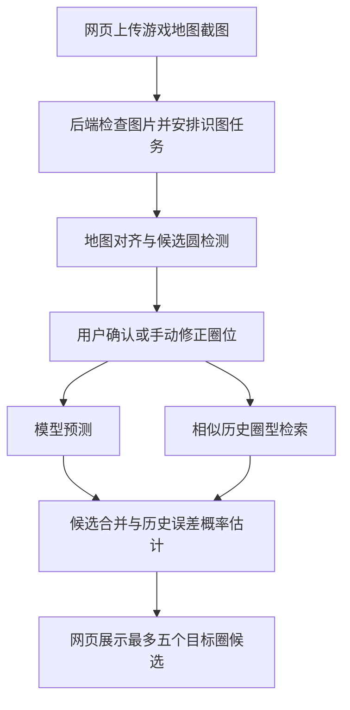

# 圈位实验室：项目概览与模块说明

更新日期：2026-10-13。

## 项目做了什么

本项目是一个面向 Apex Legends 世界尽头地图的圈位研究与预测网页。玩家上传游戏内完整地图截图，确认识别出的安全区和圈次后，系统结合训练好的模型与相似历史对局，在地图上展示最多五个目标圈候选，并给出基于历史验证误差计算的估计命中概率。

目前支持连续的第 1～3 圈输入：可以仅提供首圈，也可以在同一局中继续上传二圈、三圈截图。识别失败时，可以手动框选地图、通过三个边界点画圆，或编辑圆心和半径。已记录圈位会保留，当前标签页刷新后可以恢复；开始新对局时清空上一局记录。

项目还完成了历史样本采集、清洗去重、来源审计、独立对局评估、监督模型训练、后端服务迁移和云服务器内部部署。它既包含供玩家操作的网页，也包含支撑预测结果的数据和研究工具。

当前成果如下：

- 正式样本库包含 1,001 条已知圈与同轮揭晓目标的配对样本，其中 PUBLIC 排位来源 967 条、ALGS 比赛来源 34 条；采集已完成当前目标并保持暂停。
- 已训练三个 ExtraTrees 回归模型，分别对应一个、两个、三个已知圈的输入。
- 已实现截图自动对齐、候选圆检测、人工确认与校正、历史圈型检索、模型预测和候选概率展示。
- 已使用 FastAPI / Uvicorn 提供 API，并为识图和预测分别设置有限工作队列、限流和超时。
- 已完成目标 Linux 容器部署和并发优化；既有 Windows / Linux 回归记录均为 65 项 Python 测试通过。

这里的“最终圈”目前指历史源站揭晓的目标圈。它对应的游戏内部圈次、底图对当前排位版本的适用性，以及当前实战概率校准仍待进一步核查。已有真实截图验证覆盖一张原图及其缩小 JPEG 变体，不能据此认为所有截图场景都已验证。

## 用户使用流程

1. 上传完整世界尽头地图截图。
2. 系统定位地图并提出安全区候选。
3. 用户核对地图、圈位和圈次，必要时手动修正。
4. 后端根据已知圈数选择模型，同时检索相似历史圈型。
5. 系统合并、校正并去重候选，显示估计概率和地图标记。
6. 同局后续截图可以追加圈位，再用更多信息进行预测。



网页上传图片只在处理进程的内存中临时使用，不保存为用户图片库，也不自动加入训练数据。固定的测试截图和验收图片是开发过程中专门保留的材料。

## 模块与文件夹对应关系

项目可以按职责理解为八个主要模块。模块是功能划分，不与文件夹一一对应：例如 `ringlab/` 同时包含服务、识图、预测和离线研究代码，`scripts/` 同时提供采集与部署工具。

| 模块 | 主要职责 | 对应文件夹 | 核心文件 |
| --- | --- | --- | --- |
| 1. 网页交互 | 上传、圈位编辑、地图图层、结果展示、本局连续上传与恢复 | `web/` | `index.html`、`style.css`、`app.js`、`geometry.mjs`、`session.mjs` |
| 2. 截图识别 | 图片检查、地图配准、候选圆检测、精确特征匹配 | `ringlab/`、`web/assets/` | `vision.py`、`matching.py`、`worlds-edge.jpg` |
| 3. 圈位预测与候选整理 | 模型推理、相似历史检索、几何约束、候选去重与概率估计 | `ringlab/`、`models/`、`data/` | `model.py`、`retrieval.py`、`probability.py`、`stage-*.joblib` |
| 4. 数据采集与管理 | 同轮配对采集、清洗、去重、隔离、来源与状态记录 | `scripts/`、`ringlab/`、`data/` | `collect-ringguessr.ps1`、`ingest.py`、`data.py`、`rings.json` |
| 5. 训练与评估 | 固定对局分区、标签审计、训练内部选型、模型训练及指标报告 | `ringlab/`、`data/training/`、`data/evaluation/`、`models/` | `train.py`、`evaluate.py`、训练 / 评估 `manifest.json` 与 `results.json` |
| 6. API 服务与承载控制 | HTTP 接口、功能协调、启动核验、来源保护、有限并发、限流与超时 | `ringlab/` | `server.py`、`workbench.py`、`config.py`、`limits.py` |
| 7. 部署与发布 | 固定依赖、容器运行、反向代理示例、发布打包、远程部署与回退 | `deploy/`、`scripts/`、项目根目录 | `compose*.yaml`、`Caddyfile.example`、`Dockerfile`、依赖清单、`pack-release.py` |
| 8. 测试与验收 | 算法和接口回归、前端规则检查、真实截图验证、性能与资源记录 | `tests/`、`data/`、本机 `outputs/qa/` | `test_*.py`、JS / PowerShell 测试、各类 `*-validation.json` |

### 1. 网页交互模块

对应目录：[web/](web/)。

页面由 `index.html` 定义结构，`style.css` 负责外观及手机布局，`app.js` 负责上传、调用 API、地图缩放、圈次确认、候选切换和图层显示。

`geometry.mjs` 提供圈位有效性与三点拟合圆等几何函数。`session.mjs` 定义连续圈位合并和恢复规则，防止重复圈、跳圈或不嵌套输入覆盖已有记录；实际 `sessionStorage` 存取由 `app.js` 完成。

### 2. 截图识别模块

对应目录：[ringlab/](ringlab/) 和 [web/assets/](web/assets/)。

`vision.py` 检查 JPG / PNG 的实际格式、图片大小和像素数，将截图中的地图对齐到标准底图，再检测候选安全区。自动配准先尝试 ORB，之后使用 SIFT 与 RANSAC；也支持用户手动框选完整地图区域。

`matching.py` 实现优化后的精确 SIFT 匹配，通过分块计算和候选反向核对降低耗时，保留原有比率与双向匹配规则。

`web/assets/worlds-edge.jpg` 是网页显示和识图实际使用的底图；同目录 PNG 保留源图。识别器提出候选，圈次最终由用户确认。

### 3. 圈位预测与候选整理模块

对应目录：[ringlab/](ringlab/)、[models/](models/) 和 [data/](data/)。

`model.py` 根据已知安全区构造特征，预测目标圆心相对最后已知圈的偏移，并将结果约束在已知安全区和地图范围内。`models/stage-1.joblib`、`stage-2.joblib`、`stage-3.joblib` 分别用于首圈、前两圈和前三圈输入；文件名中的数字表示输入圈数。

`retrieval.py` 在适用的历史参考库中寻找相近圈型。当前运行参考库使用 579 条训练排位记录，不将验证或测试样本临时回灌到检索库。

`probability.py` 将历史目标相对位置迁移到当前输入，进行几何校正和相近候选去重，合并为最多五个结果。估计命中概率基于 193 条独立历史验证对局的模型误差，事件是“真实目标圆心落入候选圆”；不同候选可以重叠，概率不要求相加为 100%，也不等同于当前实战校准概率。

### 4. 数据采集与管理模块

对应目录：[scripts/](scripts/)、[ringlab/](ringlab/) 和 [data/](data/)。

`scripts/collect-ringguessr.ps1` 通过 Ring Guessr 的访客流程取得同一轮已知圈和揭晓目标；`watch-ringguessr-collection.ps1` 跟踪采集批次与停止状态。当前样本目标已经达到，采集和定时任务保持暂停。

`ringlab/ingest.py` 将原始配对响应正规化，筛选世界尽头样本、合并重复并隔离异常；`data.py` 负责样本校验、加载和原子写入；`report.py` 根据现有材料生成可读数据说明。

`data/rings.json` 是正式库，`source-modes.json` 和 `map-identification.json` 保存来源分类与地图核查依据。异常响应保留在 `quarantine-records.json`，采集进度及完成情况保留在状态快照中。本机的 `data/raw/` 保存原始响应与历史日志，`data/cache/` 保存早期接口探测材料，这两个目录不提交 GitHub。

### 5. 训练与评估模块

对应目录：[ringlab/](ringlab/)、[data/training/](data/training/)、[data/evaluation/](data/evaluation/) 和 [models/](models/)。

`evaluate.py` 按源对局 ID 及别名分组，冻结检索库、验证和测试分区，检查同局泄漏，评估历史检索、圆心误差和候选覆盖，并核查目标标签。分区、指标及报告位于 `data/evaluation/`。

`train.py` 核对固定分区和数据指纹，在训练内部进行五折分组选型，训练三个圈数的回归模型，再记录验证结果。`data/training/` 保留训练清单、选型过程、指标和报告；模型二进制文件位于 `models/`。

训练清单记录数据与模型 SHA-256、特征格式、适用范围和依赖版本，供运行时验证材料一致性。训练是离线步骤，普通网页请求只运行推理。

### 6. API 服务与承载控制模块

对应目录：[ringlab/](ringlab/)。

`server.py` 是 FastAPI / Uvicorn 服务入口，提供以下接口，并按白名单提供网页静态文件：

| 接口 | 作用 |
| --- | --- |
| `GET /api/health` | 查询初始化、健康和待处理任务状态 |
| `GET /api/meta` | 获取适用范围、示例输入和页面所需元信息 |
| `POST /api/recognize` | 识别上传截图并返回对齐预览与圈位建议 |
| `POST /api/predict` | 根据确认后的已知圈计算候选结果 |

`workbench.py` 加载并校验数据、模型和识图器，协调预测与识别功能。`config.py` 验证运行参数；`limits.py` 管理限流、工作线程和有限排队。

当前默认预测容量为 1 个计算任务加 7 个等待名额，识图容量为 1 个计算任务加 3 个等待名额。超容量会明确返回 503；计算任务超时后仍保留占用，直到实际结束，避免任务无限积压。识图忙碌时，健康查询和预测仍可独立响应。

### 7. 部署与发布模块

对应目录：[deploy/](deploy/)、[scripts/](scripts/) 和项目根目录。

根目录 `Dockerfile` 构建固定 Python 运行镜像，`requirements.lock.txt` 锁定依赖，`.dockerignore` 控制镜像构建材料。`deploy/compose.internal.yaml` 用于当前服务器内部运行；`compose.yaml` 用于配置正式 HTTPS Origin 后的运行；`Caddyfile.example` 提供 HTTPS 反向代理示例。

`scripts/start-web.ps1` 启动本地服务，`pack-release.py` 制作白名单发布包，`fetch-base-image.py` 制作官方基础镜像离线包，`remote-deploy.py` 使用本机已有部署连接参数辅助 SSH / SCP 操作。连接参数和私钥不进入仓库。

当前云服务已在 Ubuntu ECS 内部运行，仅监听服务器 `127.0.0.1:8765`，容器限制为 1 GiB / 2 CPU。域名已经取得，备案、正式 HTTPS 接入和公网浏览器验收尚未完成，配置示例存在不代表网站已经公开上线。

### 8. 测试与验收模块

对应目录：[tests/](tests/)、[data/](data/) 和仅在本机保留的 `outputs/qa/`。

Python 测试覆盖入库、评估分区、模型、概率、图像识别、精确匹配、服务队列、超时和 HTTP 行为。JavaScript 测试检查三点画圆及本局状态规则；PowerShell 测试使用模拟请求检查采集模式和恢复逻辑。

`tests/fixtures/worlds-edge-user.png` 是固定真实截图回归样本，不进入训练库。`data/web-validation.json`、`deployment-validation.json`、`server-validation.json` 和 `concurrency-validation.json` 分别保存网页、本机部署、最初云部署和最新并发优化的验收结果。

`scripts/load-test.py` 与 `validate-deployment.py` 提供有限压测和临时服务验收。最近云端记录显示，两人识图最长约 5.9 秒、四人同时识图最长约 10.9 秒；这些是已测截图和当时服务器条件下的结果，完整范围见 [并发验收报告](data/concurrency-validation.json)。

## 文件夹总览

```text
apex-ringlab/
├── web/                 网页与地图底图
├── ringlab/             后端、识图、推理、数据处理及离线研究代码
├── models/              三个训练好的圈位模型
├── data/                正式库、来源依据、状态与验收报告
│   ├── training/        训练清单、选型及验证结果
│   ├── evaluation/      独立评估分区、标签审计及指标
│   ├── raw/             原始响应与采集日志，仅本机保留
│   └── cache/           早期接口研究缓存，仅本机保留
├── scripts/             采集、启动、压测、打包及部署工具
├── deploy/              Compose 和 HTTPS 代理示例
├── tests/               自动回归与固定测试截图
├── outputs/             备份、发布包与 QA 工作材料，仅本机保留
├── .venv/               本机 Python 环境，不提交仓库
├── Dockerfile           Linux 运行镜像构建
├── requirements*.txt    运行及开发依赖
├── .gitignore           忽略环境、缓存、输出和认证配置
└── .gitattributes       保留原始字节，保护数据与模型指纹
```

以上目录树同时解释仓库内容与本机工作目录。标记“仅本机保留”的目录不会随 Git 克隆出现；运行需要的正式数据、模型、底图和源码已包含在仓库中。

## 继续了解项目

- [安装与启动说明](PROJECT_OVERVIEW.md)：安装、启动、常用命令与研究结果。
- [网页使用说明](WEB_GUIDE.md)：玩家操作流程。
- [项目计划](PROJECT_PLAN.md)：需求、里程碑和后续工作。
- [部署说明](DEPLOYMENT.md)：环境配置、部署验收与回退。
- [交接说明](HANDOFF.md)：当前版本和继续开发所需状态。
- [逐文件说明](FILE_GUIDE.md)：每个项目文件的具体用途。

